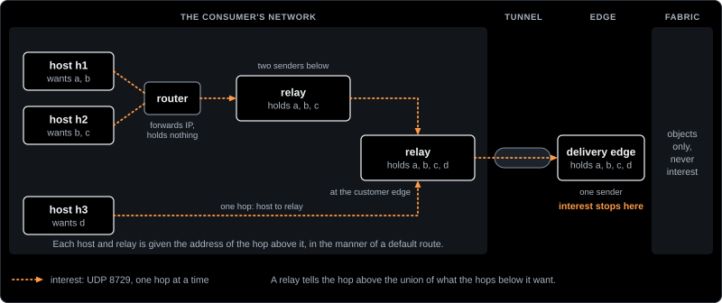
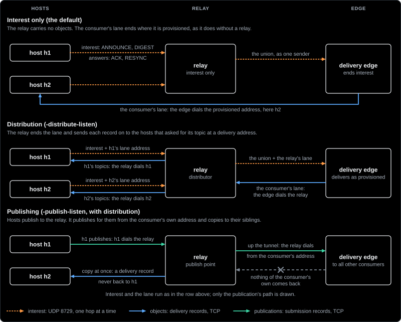

# interest-relay

[](https://github.com/lightwebinc/interest-relay/actions/workflows/ci.yml)
[](https://github.com/lightwebinc/interest-relay/actions/workflows/codeql.yml)
[](https://github.com/lightwebinc/interest-relay/releases)
[](https://pkg.go.dev/github.com/lightwebinc/interest-relay)
[](LICENSE)

> Part of the [**BSV Layered Multicast**](https://github.com/lightwebinc/bsv-multicast) open-source project. See the main repository for the full architecture, design docs, and BRC specifications.

A small daemon that relays **topic interest**: which overlay topics the
hosts of a network want delivered, now.

A multicast delivery edge delivers a topic to a consumer only while someone
has asked for it. The process that wants the topic is often not the machine
that holds the consumer's tunnel: it may be several network hops away,
inside the consumer's own network. A host says what it wants to the nearest
relay. The relay holds the union of what the hosts below it want and
announces that union to its own upstream: another relay, or the delivery
edge at the far end of the tunnel. Interest stops at the edge; the fabric
never carries it.



## What it does

| Mode | Flag | The relay |
|---|---|---|
| Interest only | the default | carries interest upward and answers downward. No object passes through it |
| Distribution | `-distribute-listen` | also ends the consumer's lane, and sends each object on to the hosts that asked for its topic |
| Publishing | `-publish-listen` | is also the domain's publish point: hosts publish to it, it publishes for them from the consumer's own address and copies each object at once to the siblings that asked for it |



What a relay is, in short:

- **Soft state only.** Every topic lapses unless its sender refreshes it. A
  refresh is one small datagram, whatever the size of the sender's set.
  Nothing is kept on disk.
- **One sender to the hop above.** The upstream sees the relay, not the
  hosts behind it, so per-host state never grows upstream.
- **Configured like a default route.** Each host and relay is given the
  address of the hop above it. Nothing is discovered.
- **Small on the wire.** One UDP datagram per message, never larger than
  1232 bytes, so no hop fragments it.
- **Embeddable.** The relay is a package (`relay/`); a process that already
  sits where a relay would can run one on its own sockets.

The protocol is a draft (wire version 0) and its wire may still change.

## Quick start

```sh
make all

# A relay that takes interest from one prefix and announces to one upstream.
build/interest-relay \
  -upstream '[2001:db8:f::1]:8729' \
  -allow    '2001:db8:c::/48'

# From a host inside that prefix: ask for two topics and watch the answers.
build/interest-announce -upstream '[2001:db8:a::1]:8729' tm_example tm_other
```

To try it on one machine, with no network and no edge, `interest-terminus`
stands in for the delivery edge:

```sh
build/interest-terminus -listen '[::1]:8729' -shard-bits 3 -groups 0,1,2,3,4,5 &
build/interest-relay -listen '127.0.0.1:8729' -upstream '[::1]:8729' -allow 127.0.0.0/8 &
build/interest-announce -upstream '127.0.0.1:8729' tm_example tm_other tm_orders
```

```text
not_served  tm_orders
ok  tm_example
ok  tm_other
# upstream 127.0.0.1:8729 reachable=true synced=true held=2 scope=6 of 8 groups lifetime=300s
# topics 3: not_served=1 ok=2
```

The stand-in delivers six of eight groups, and `tm_orders` falls in one of
the other two: the host is told that no stream will come for it.
`curl -s http://localhost:9600/state` shows the relay's table.

Distribution and publishing, with every flag, are in
[docs/configuration.md](docs/configuration.md).

## Documentation

- [How it works](docs/architecture.md): roles, the four datagrams, soft state, scope, restarts, loops, distribution, publishing
- [Network traffic and topology](docs/network.md): where relays go, what crosses each link, who opens each connection, what to let through a firewall
- [Configuration](docs/configuration.md): every flag and environment variable
- [Operations](docs/operations.md): metrics, health, the state endpoint, what to alert on
- [Testing](docs/testing.md): the test tools and the network namespace tests

The protocol itself (the wire, the announcer and the receiver) is the
[`interest`](https://pkg.go.dev/github.com/lightwebinc/shard-common/interest)
package of [shard-common](https://github.com/lightwebinc/shard-common). The
objects a distributing relay carries are the delivery and submission records
of the BEEF object plane,
[BRC-148](https://github.com/bsv-blockchain/BRCs/blob/master/transactions/0148.md)
and
[BRC-149](https://github.com/bsv-blockchain/BRCs/blob/master/transactions/0149.md).

## Requirements

- Go 1.26.2 or later, to build
- An upstream that speaks topic interest: a delivery edge that serves the
  consumer, or another relay
- For the network namespace tests: Linux with unprivileged user namespaces,
  or root

## Build

```sh
make all           # the daemon and the tools, into build/
make verify        # what CI runs: formatting, vet, tests under -race, license freshness
make test-netns    # the real binaries on a routed network of namespaces
make image         # a container image
```

## Layout

```
.
├── main.go                  # the daemon: flags, sockets, wiring
├── relay/                   # the relay as a package, to embed in another program
├── distributor/             # ends a lane, sends each record to the hosts that asked
├── publish/                 # the publish point: takes submissions, sends them up, copies to siblings
├── config/                  # flags and environment
├── metrics/                 # the bir_* series, health, readiness, the state endpoint
├── cmd/interest-announce/   # an announcer for the command line
├── cmd/interest-terminus/   # a stand-in for a delivery edge, for testing
├── cmd/lane-feed/           # a lane writer or a publisher, for testing
├── cmd/lane-sink/           # a host's lane or an ingress, for testing
├── test/netns/              # multi-hop, distribution and publishing tests in network namespaces
├── docs/                    # architecture, network, configuration, operations, testing, figures/
├── Dockerfile
├── Makefile
└── .github/workflows/{ci,codeql,image-publish,release,scorecard,vuln,workflow-lint}.yml
```

## Observability

Prometheus series are `bir_*` on `-metrics-addr` (default `:9600`), with
`/healthz`, `/readyz` and the relay's table as JSON on `/state`; see
[docs/operations.md](docs/operations.md).

## Status

A draft protocol with a working implementation. The relay is exercised by
unit and loopback tests under the race detector and by the real binaries on
routed networks of namespaces, with loss, restarts at every hop, and hosts
that die without a word; see [docs/testing.md](docs/testing.md). The wire
is version 0 and is not frozen: build a relay and the hops around it from
the same shard-common release.

Releases and notes live on [GitHub Releases](https://github.com/lightwebinc/interest-relay/releases); there is no CHANGELOG.

## Contributing

See [CONTRIBUTING.md](CONTRIBUTING.md). Report vulnerabilities privately, as
[SECURITY.md](SECURITY.md) describes.

## License

Apache-2.0 (see [LICENSE](LICENSE) and [NOTICE](NOTICE)). The licenses of
the modules the static binaries link are in
[LICENSE-THIRD-PARTY](LICENSE-THIRD-PARTY).
