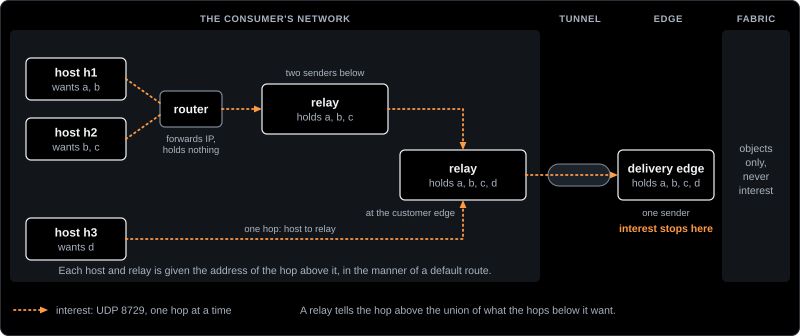
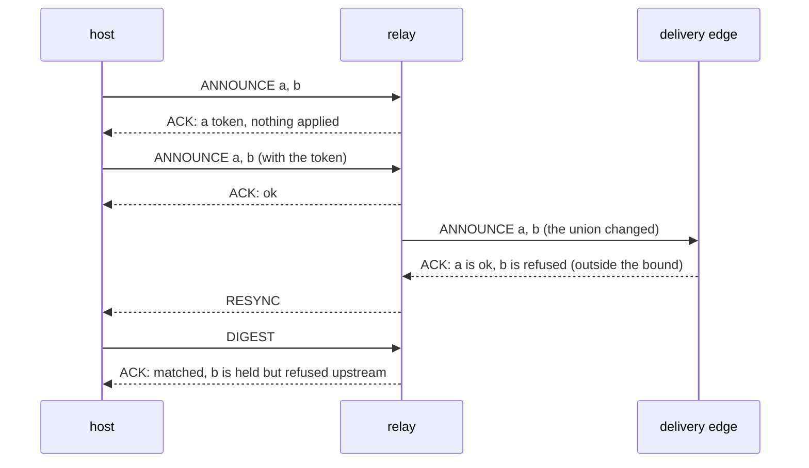
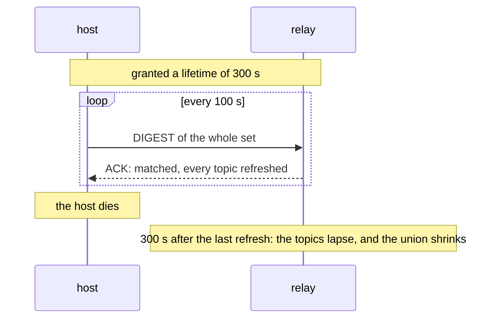
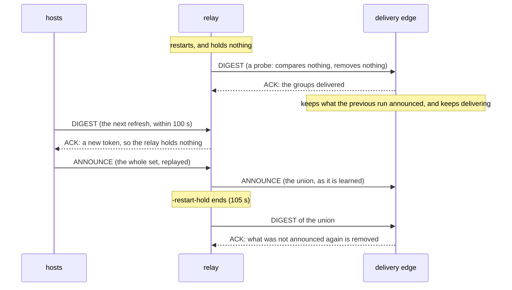
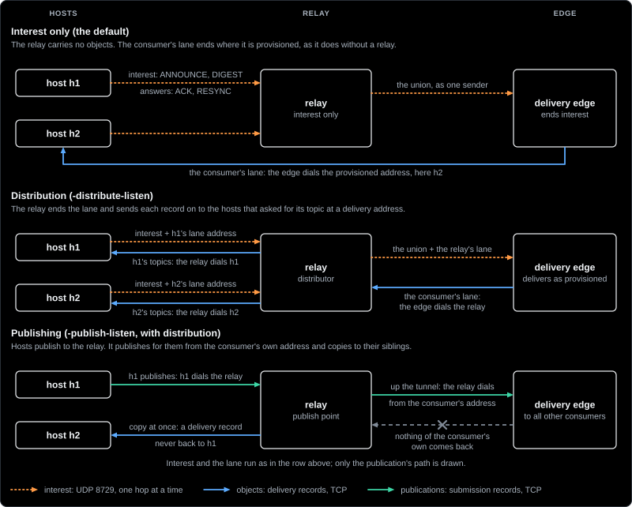
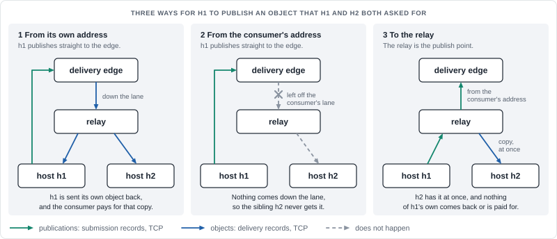

# How the relay works

## The problem it solves

A consumer of overlay topics is served by a multicast delivery edge, at the
far end of a tunnel. The edge delivers a topic only while someone has asked
for it. The process that wants the topic is often not the machine that holds
the tunnel: it may be several network hops away, inside the consumer's own
network. Something has to carry its interest to the edge.

That is the relay. Each relay is configured with an upstream, in the manner
of a default route, and accepts interest from a set of prefixes below it.

Where relays go in a network, what crosses each link and who opens each
connection are in [Network traffic and topology](network.md).

## Roles

| Role | What it does | Program |
|---|---|---|
| Announcer | wants topics; tells its upstream | any program using the client; `interest-announce` |
| Relay | holds the union of what is below it; tells its own upstream | `interest-relay` |
| Terminus | where interest ends: the delivery edge | the edge; `interest-terminus` for tests |

The same four datagrams are used at every hop. An announcer whose own
machine holds the tunnel talks to the edge directly, and a relay is never
required.

| Datagram | From | Says |
|---|---|---|
| ANNOUNCE | sender | what changed: topics added, each with a lifetime, or withdrawn |
| DIGEST | sender | the count and digest of the sender's whole set |
| ACK | receiver | the answer to either: a token to echo, the digest of the set held, the lifetimes granted, a status for each topic not simply accepted, the groups delivered |
| RESYNC | receiver | a poke: check in now |

One datagram is one message, sent to UDP port 8729 by default and never
larger than 1232 bytes. The wire is specified by the
[`interest`](https://pkg.go.dev/github.com/lightwebinc/shard-common/interest)
package of shard-common.

Each hop answers for itself, at once. What the hop above says later reaches
the host at its next check-in, and the relay pokes the hosts that hold the
topic so that the check-in is now.

## What a relay keeps

| State | Per | Lifetime |
|---|---|---|
| the topics a sender announced | sender (source address and sender identity) | soft: each topic lapses unless refreshed |
| the union of those topics | relay | derived |
| how each upstream answered | upstream | for as long as the topic is wanted |

A topic that two senders want is announced upstream once, and stays until
the second sender lets go.

The upstream sees one sender: the relay. It does not learn how many hosts
stand behind it.

## Soft state

A sender is granted a lifetime for what it announces and refreshes at a
third of it. A refresh is one small datagram that carries a digest of the
sender's whole set, whatever its size. If the digest matches what the relay
holds, every topic is refreshed at once.

If a sender goes silent, what it announced lapses when the lifetime runs
out. If it leaves in an orderly way, it can withdraw everything in one
datagram.

## Loss and reordering

Nothing is applied out of order: a relay applies a message only if its
sequence number is above the last one it applied for that sender. A sender
does not retransmit a datagram. What was not acknowledged is still to be
said, and is said again as it stands now.

Every acknowledgment carries a digest of the set the relay holds for the
sender. If it is not the set the sender expects, the sender replays its
whole set and ends with a digest that removes whatever the replay did not
mention.

## Delivered scope

An upstream may deliver only some groups of the object plane. A topic that
maps to a group it does not deliver has no stream behind it.

The edge says which groups it delivers. Each relay passes that down, so a
relay refuses a topic that nothing above it serves, and the host that asked
is told. A host that knows the scope does not send such topics at all.

With several upstreams, a topic is announced to every upstream that serves
its group and to no other. A topic that all of them serve goes to all of
them, so a standby already holds it when it takes over.

A topic the relay holds but cannot get served (refused upstream for another
reason, or announced before the scope was known) is kept and asked for
again at each refresh. The sender is told it is held but unserved, and has
nothing to do.

## Restarts

| What restarts | What happens |
|---|---|
| The upstream | It holds nothing. The relay sees a new token in the next answer and replays its set. An upstream that knows the relay's address can ask at once instead of waiting for the refresh. |
| The relay | It starts empty and learns its set again as the senders below check in, which takes up to one refresh interval. Until then its upstream keeps what the previous run announced: the relay does not let the upstream drop anything for the length of `-restart-hold`. Nothing that is still wanted stops being delivered, as long as the hold covers the refresh interval of every sender below (see `-restart-hold`). An upstream that pokes the relay during the hold, to say that what it serves changed, is asked for its scope at once. |
| A sender | It replays its set. What it no longer wants is removed when the replay ends. |

A relay restart, with the default lifetime and hold:

The relay's identity toward its upstream is derived from the host name and
`-sender-label`, so it is the same after a restart. That is what lets the
upstream match the new run to what the old one announced.

## Who may announce

A relay accepts interest only from the prefixes in `-allow`. Anything else
is ignored without an answer.

A sender must also echo a token that the relay issues to its source
address. The first message from a new sender is answered with the token and
nothing else, and is not applied. This proves the sender can receive at the
address it claims, and it keeps the answer to an unproven source no larger
than the request.

There is no signature. Inside a network domain the relay trusts the
prefixes it was given.

## Loops

A relay never accepts interest from the address of one of its own
upstreams, so two relays pointed at each other do not feed each other.

Every message carries a hop count: zero from an announcer, and from a relay
one more than the deepest sender below it. In a longer ring the count
climbs until it passes `-max-hops` and the message is refused, which stops
a withdrawn topic from living on in the ring. The refusal is counted
(`bir_messages_total{outcome="hop_limit"}`); any value above zero means the
relays are configured in a ring.

## Distribution

Off by default. With `-distribute-listen` set, the relay also carries
objects: it ends the consumer's lane and sends each record on to the hosts
below that asked for its topic.

A host asks for delivery by naming a delivery address with its topics: a
unicast stream of delivery records, to a host and port
(`interest-announce -deliver-to`). The relay answers:

| The host names | The relay |
|---|---|
| its own address, or one inside the `-allow` prefix it announces from | keeps the topic and the address (`ok`) and sends the topic's records there |
| any other address | refuses the topic (`bad_address`): an unsigned datagram must not point a paid stream at a host outside the sender's prefix |
| another kind of delivery (a multicast group, or frames) | keeps the topic and drops the address (`address_not_honored`) |
| no address | keeps the topic; the host gets no records from the relay, which now ends the lane |

Inside one `-allow` prefix a sender may name any host, so the prefixes
should be no wider than the trust between the hosts in them.

Upward, the relay names its own lane (`-distribute-advertise`) with the
union. An edge does not honor a delivery address and delivers as
provisioned, so the consumer's lane must be provisioned to that address. A
distributing relay above does honor it, so distributing relays can be
stacked.

Each record that arrives on the lane is written, unchanged, to every host
that asked for any of its deliverable topics, on one TCP stream per host.
The edge delivers a record under its first topic's TopicID to a consumer
that asked for any of the record's first few names (`-deliver-topics`, the
edge's cap for a consumer tunnel, 3 by default), so the relay reads the
names in the record too: a host that asked for the second name gets it, a
host that asked for two of its names gets it once, and a host that asked
for a label past the deliverable names does not. A record that no host
asked for is counted and dropped. Routes follow interest: a host's records
start when its address is honored and stop when its topics are withdrawn
or lapse. Two senders that name the same address for a topic make one
route, which stays until the second lets go.

Delivery is at most once, as on the lane. Each host has a queue, bounded in
records and in bytes (`-distribute-queue`, `-distribute-queue-mib`). A
host's stream opens when its first record arrives. A host that falls behind
loses what does not fit its queue; a record larger than the byte bound
still goes to a host with nothing waiting. While a host cannot be reached
its records are shed, and it is dialed again with a backoff of up to ten
seconds. A host that takes longer than ten seconds to accept a megabyte has
its stream closed, and is dialed again; one that reads slowly but steadily
keeps its stream, however large the record. All of it is counted
(`bir_distributor_host_records_shed_total`), and the lane and the other
hosts never wait for one host.

What waits for a host takes up to `-distribute-queue-mib`, or one record
when a record is larger, besides the record being written to it. A sender
names at most one address for each topic
it holds, so `-max-senders` and `-max-topics-per-sender` bound the number
of hosts.

The lane listener checks no source address. As for any lane endpoint, let
only the delivery edge, or the distributing relay above, reach
`-distribute-listen`.

## Publishing

Off by default; it needs distribution. With `-publish-listen` set, the
relay is also its domain's publish point: the hosts publish to it, and it
publishes for them.

Hosts behind one relay share one consumer: one tunnel and one lane. The
edge leaves a consumer's own publications off its lane, matching the address
a submission came from against the consumer's own. A host that publishes
through the tunnel from that address never reaches its siblings through the
edge; one that publishes from another address is sent its own object back,
and the consumer pays for that copy. The relay solves both:

| Step | What the relay does |
|---|---|
| take | each BRC-149 submission record a host sends to `-publish-listen` (a bridge's `-edge-ingress` names the relay); a connection from outside `-allow` is closed |
| bound | the edge's ingress bounds, applied before anything is copied: the object size (`-publish-max-object-mib`) and its BEEF marker, a host's budget and the relay's (objects and MiB per second). A record that fails one is skipped and counted, and the stream goes on |
| up | the record, unchanged, up the tunnel from the consumer's own address (`-publish-source`) to the edge's ingress (`-publish-ingress`), through the overlay bridge's up-tunnel client: failover and fail-back between the ingress addresses, and a record counted confirmed only once the ingress acknowledged it |
| copy | once the up-tunnel queue has taken the record, the delivery record the edge would send (the first name's TopicID, then the record) to every host that asked for any of its deliverable names, through the distributor, skipping hosts at the publisher's address |

What follows:

- Nothing of a host's own comes back from the edge, or is billed: the
  relay publishes from the consumer's address, which the edge excludes.
- Siblings get the object without the round trip to the edge and back.
- Every other consumer gets it from the edge as before.
- A record the up-tunnel queue cannot take is not copied, so a sibling
  never holds what the other consumers will not get.

It keeps no state beyond what it has: which host asked for which topic,
refreshed by the hosts. No object is remembered. The publisher is skipped by
its source address, compared with the address each host names its lane at,
so:

- a host publishes from the address it names its lane at (a bridge's
  `-publish-source` and `-interest-deliver-to` name the same address); one
  that publishes from another is sent its own objects back, a duplicate its
  engine drops;
- hosts that share one address are one host to the relay: a publication
  from one is copied to none of the others.

It scales by consumers, not by relays talking to each other. One relay
serves one consumer; a domain larger than one relay serves becomes several
consumers, each a tunnel with its own relay. The edge copies between them
as it copies between any consumers, and each relay copies only among its
own hosts.

A host's bridge may list the edge's ingress after the relay in its
`-edge-ingress`, for when the relay is down. It then publishes from its own
address and is sent its own objects back until the relay returns, which
costs a duplicate, not a loss.

## What the relay does not do

- Unless it distributes, it carries no objects: delivery reaches the
  consumer where the consumer's lane ends, as it does without a relay.
- Unless it distributes, it does not honor a delivery address. A sender
  that names one is told so (`address_not_honored`) and its interest is
  still held.
- Distributing, it does not store, reorder or repair a record, and it sends
  only to unicast hosts, never to a multicast group.
- It does not discover its upstream. The upstream is configuration.
- It keeps nothing on disk.
