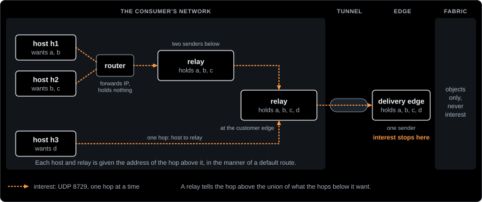
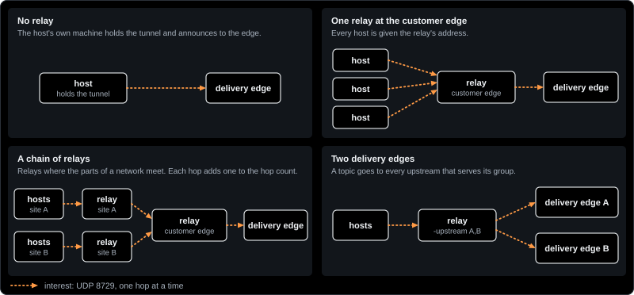
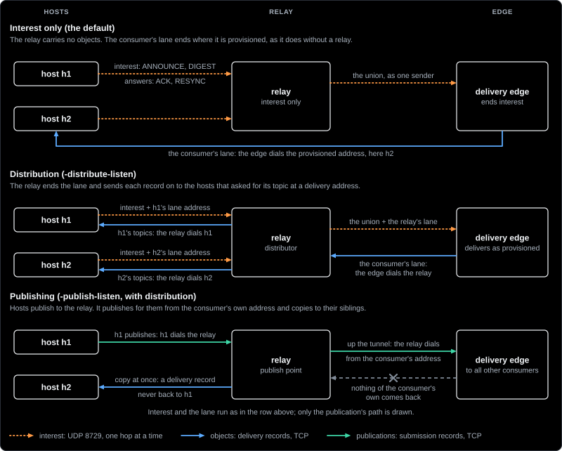
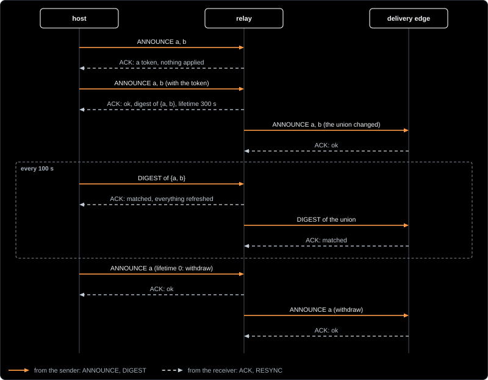
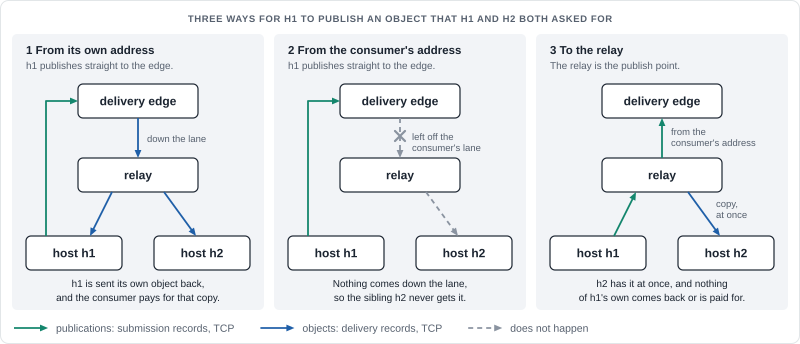

# Network traffic and topology

Where relays go in a network, what crosses each link, who opens each
connection, and what a firewall has to let through. The reasons behind the
behavior are in [How the relay works](architecture.md).

## Three kinds of traffic

| Traffic | Carried as | Direction | Present |
|---|---|---|---|
| Interest | UDP datagrams, port 8729 by default, one hop at a time | from the hosts toward the edge; answers come back the same way | always |
| Objects | delivery records on a TCP stream, a lane | from the edge toward the hosts | through the relay only when it distributes |
| Publications | submission records on a TCP stream | from the hosts toward the edge | through the relay only when it is the publish point |

Interest is the only traffic a relay carries by default. It is control
traffic: it names topics and never carries an object.

## Where relays go

A hop is one announcer and the receiver it is configured with, however many
routers lie between them. Routers forward the datagrams as any other and
hold nothing. The same four datagrams are used at every hop, so the shapes
below are built from one part.

### No relay

A host whose own machine holds the tunnel announces to the edge directly.

### One relay at the customer edge

The usual shape: the machine that holds the tunnel runs the relay, and
every host in the network is given its address.

### A chain of relays

A larger network places relays where its parts meet. Each relay accepts
interest from the prefixes below it (`-allow`) and announces to the one
above. Each hop adds one to the hop count a message carries; a message that
has crossed more than `-max-hops` relays (16 by default) is refused, which
is what stops a ring.

### Two delivery edges

A relay may be given several upstreams. A topic is announced to every
upstream that serves its group, so an edge that takes the consumer over
already holds what the consumer wants. An edge that starts serving the
consumer can also ask the relay to check in at once, without waiting for
the next refresh.

### A distributing relay

The relay ends the consumer's lane and sends each object on. Hosts name
the address their own lane listens on when they announce, and the relay
names its own to the hop above. The second row of the figure under
[What crosses each link](#what-crosses-each-link) shows the traffic.

Distributing relays can be stacked: a distributing relay honors the lane
address of the distributing relay below it, as it honors a host's.

## What crosses each link

### Connections and who opens them

`h` is a host below the relay, `up` the hop above it (a relay or the edge).

| Traffic | Transport | From | To | Opened by |
|---|---|---|---|---|
| Interest from below | UDP | `h`, any port | the relay, `-listen` (port 8729) | the host. Answers leave the relay from the address the host sent to |
| Interest to above | UDP | the relay, `-upstream-bind` (a port the kernel chooses) | `up`, port 8729 | the relay. Answers return to that socket |
| A poke from above | UDP | `up` | the relay's announcing socket, or its `-listen` port | the upstream, to make the relay check in now |
| The consumer's lane | TCP | the edge, or a distributing relay above | the relay, `-distribute-listen` | the hop above |
| A host's records | TCP | the relay | the delivery address the host named | the relay, when the host's first record arrives |
| A host's publications | TCP | `h` | the relay, `-publish-listen` | the host |
| Publications to the edge | TCP | the relay, from `-publish-source` | the edge's ingress, `-publish-ingress` | the relay |
| Metrics and health | HTTP | a scraper | the relay, `-metrics-addr` (port 9600) | the scraper |

The relay never opens a connection toward a host that did not name an
address, and never sends to a multicast group.

### What to let through a firewall

For a relay that carries interest only:

- UDP to the relay's `-listen` port from the prefixes in `-allow`, and the
  answers back.
- UDP from the relay to each upstream's port 8729, and the answers back. A
  stateful filter that tracks UDP flows covers both answers. A poke is not
  an answer to anything: to let an upstream wake the relay, also admit UDP
  from the upstream's address to the relay's `-listen` port.

Distributing, also:

- TCP from the hop above to `-distribute-listen`, and from nothing else:
  the lane listener checks no source address.
- TCP from the relay to each host's lane.

As the publish point, also:

- TCP from the prefixes in `-allow` to `-publish-listen`. A connection from
  any other address is closed.
- TCP from `-publish-source` to the edge's ingress, through the tunnel.

Keep `-metrics-addr` inside the management network: `/state` lists every
sender and upstream, and `/loglevel` changes the log level.

## Interest on the wire

One message is one UDP datagram, never larger than 1232 bytes: the IPv6
minimum MTU less the IPv6 and UDP headers. No hop fragments it, on a tunnel
or off one.

| Datagram | Sent by | Carries | Size |
|---|---|---|---|
| ANNOUNCE | the sender | changes: topics added, each with a lifetime, or withdrawn | 40 bytes, and 38 for each topic without extensions; at most 31 such topics in one datagram |
| DIGEST | the sender | the count and digest of its whole set | 88 bytes, whatever the size of the set |
| ACK | the receiver | the token to echo, the digest of the set it holds, the lifetimes it grants, a status for each topic it did not simply accept, the groups it delivers | 40 bytes for a token alone, otherwise 100 and up |
| RESYNC | the receiver | a poke: check in now | 40 bytes |

A sender refreshes at a third of the lifetime it was granted, so one lost
refresh does not let a topic lapse. With the default
lifetime of 300 seconds that is one 88-byte DIGEST and its answer every 100
seconds for each sender, whether it holds one topic or ten thousand.
Changes cost in proportion to what changed. A full replay, after a restart
above or a mismatch, costs one ANNOUNCE for every 31 topics.

Each hop answers for itself, at once. What the hop above says later
(refused, or not served) reaches the host at its next check-in, and the
relay pokes the hosts that hold the topic so that the check-in is now.

## Objects and publications on the wire

A lane is one TCP stream of delivery records: a 32-byte TopicID, a 4-byte
big-endian length, and the object. The distributor writes each record
unchanged to every host that asked for one of its deliverable topics, one
TCP stream for each host. It adds no framing and keeps no copy.

A publication is one submission record on a TCP stream from a host to
`-publish-listen`. The relay sends the record unchanged to the edge's
ingress, and writes the delivery record the edge would have sent to each
sibling that asked.

Hosts behind one relay share one consumer: one tunnel and one lane. The
edge leaves a consumer's own publications off its lane, and it knows them
by the address they come from. The first two ways in the figure are what
that rule does to a host that publishes for itself; the third is the
publish point.

### What bounds the traffic

| Path | Bound | When it is reached |
|---|---|---|
| Interest from below | `-max-senders`, `-max-topics-per-sender`, `-change-rate` | a topic is refused with a reason, and the sender is told |
| A host's records | `-distribute-queue` records and `-distribute-queue-mib` waiting for one host | that host loses what does not fit; the lane and the other hosts do not wait |
| The lane | `-distribute-max-object-mib` | a longer record is a broken lane, which is closed |
| A host's publications | `-publish-max-object-mib`, and a budget for each host and for the relay, in objects and MiB per second | the record is skipped and counted; the stream goes on |
| Publications to the edge | `-publish-queue` records and `-publish-queue-mib` waiting to go up | the record is refused and is not copied to siblings |

Delivery through a relay is at most once, as it is on the lane. A relay
stores nothing, reorders nothing and repairs nothing.

## Addresses

- Every address may be IPv6 or IPv4. The examples use IPv6.
- A receiver answers from the address a datagram was sent to, and a sender
  accepts answers only from the address it sends to. On a machine with
  several addresses, give the hosts the address the relay should be reached
  at; a wildcard `-listen` then answers correctly on Linux.
- A sender is known by its source address and its sender identity, and
  must be able to receive at the address it sends from: the relay's first
  answer to a new sender is a token to echo, and nothing is applied until
  it comes back.
- A delivery address must be the sender's own, or inside the `-allow`
  prefix the sender announces from, and the relay must be able to open a
  connection to it.
- A relay does not need a tunnel. Only the last relay before the edge
  announces through one.
